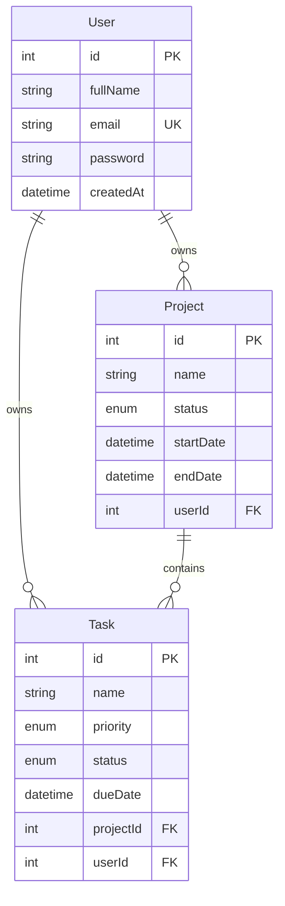

# ProjectFlow — Project Management System

Full-stack project & task manager: a **Next.js** web app and an **Expo / React Native** Android app sharing one **NestJS** REST API and one **PostgreSQL** database. Same account works on web and mobile.

## Features
- Register / login / logout, bcrypt-hashed passwords, JWT with expiry
- Projects: CRUD, status (Not Started / In Progress / Completed), dates, search by name, filter by status
- Tasks: CRUD, priority (Low/Medium/High), status (Pending/In Progress/Completed), due date, mark complete, search + status/priority filters
- Dashboard with live DB counts (projects, tasks, completed, pending, projects in progress)
- Mobile: SecureStore token storage, session restore, 401 → session-expired + redirect to login, pull-to-refresh, loading / empty / error states
- Per-project task filter (web dropdown, mobile chips, `GET /api/tasks?projectId=`)
- Request logging, Docker (`docker compose up --build`), GitHub Actions CI (workflow file in `docs/github-actions-ci.yml`; copy to `.github/workflows/ci.yml` to enable)
- Per-user data isolation on every endpoint, DTO validation, rate limiting

## Tech stack
| Layer | Tech |
|---|---|
| Backend | NestJS 12, Prisma 6, PostgreSQL, Passport-JWT, bcrypt, class-validator, @nestjs/throttler |
| Web | Next.js 16, React 19, Tailwind 4 |
| Mobile | Expo 58, Expo Router, React Native 0.88, TypeScript, expo-secure-store |

## Architecture
```
 Next.js web ──┐
               ├── HTTPS/JSON + Bearer JWT ──> NestJS API (/api) ──Prisma──> PostgreSQL
 Expo Android ─┘
```

## Folder structure
```
backend/    NestJS API (src/auth, projects, tasks, dashboard, prisma) + prisma/schema & migrations + scripts/
frontend/   Next.js web app (app/page.tsx)
mobile/     Expo app (src/app screens, src/services API layer, src/context auth)
docs/       API.md, ER-DIAGRAM.md
render.yaml Render blueprint (API + Postgres)
```

## Prerequisites
Node.js 22+, PostgreSQL 14+, (mobile) Expo Go or an Android device/emulator, (APK) an Expo account.

## Installation & database setup
```bash
cd backend && npm install            # also runs prisma generate
cp .env.example .env                 # then edit DATABASE_URL and JWT_SECRET
npx prisma migrate deploy            # creates tables from backend/prisma/migrations
cd ../frontend && npm install
cd ../mobile && npm install
```

## Environment variables
| App | Variable | Purpose |
|---|---|---|
| backend | `DATABASE_URL` | PostgreSQL connection string (secret) |
| backend | `JWT_SECRET` | JWT signing key (secret, required — server refuses to start without it) |
| backend | `JWT_EXPIRES_IN` | token lifetime, default `1d` |
| backend | `PORT` | default `5000` |
| backend | `CORS_ORIGIN` | comma-separated allowed web origins, `*` = any |
| backend | `RATE_LIMIT_PER_MINUTE`, `AUTH_RATE_LIMIT_PER_MINUTE` | defaults 120 / 20 |
| frontend | `NEXT_PUBLIC_API_URL` | public API base URL, e.g. `http://localhost:5000/api` |
| mobile | `EXPO_PUBLIC_API_URL` | public API base URL (never put secrets in `EXPO_PUBLIC_*`) |

Copy each `.env.example`; real `.env*` files are git-ignored.

## Run locally
```bash
cd backend  && npm run build && npm run start:prod    # or: npm run start:dev   (http://localhost:5000/api)
cd frontend && npm run dev                            # http://localhost:3000
cd mobile   && npx expo start                         # set EXPO_PUBLIC_API_URL=http://<your-LAN-IP>:5000/api first
```
Demo data (via the real API): `cd backend && npm run seed:demo`. API smoke test (40 checks): `npm run test:api`.

## API endpoints
Summary — full request/response docs in [docs/API.md](docs/API.md).
`POST /api/auth/register|login|logout`, `GET /api/auth/me`, `GET|POST /api/projects`, `GET|PUT|DELETE /api/projects/:id`, `GET|POST /api/tasks`, `GET|PUT|DELETE /api/tasks/:id`, `GET /api/dashboard`, `GET /api` (health).

## Database (ER diagram)

Details: [docs/ER-DIAGRAM.md](docs/ER-DIAGRAM.md). All foreign keys cascade on delete.

## Authentication
Login/register return a JWT (`sub` = user id). Clients send `Authorization: Bearer <token>`. Web keeps the token in `localStorage`; Android keeps it in `expo-secure-store` (Keystore-backed), web-preview falls back to `localStorage`. Logout is client-side token disposal (stateless JWT).

## Security
bcrypt (cost 10) · JWT secret from env, expiry enforced, malformed/expired/wrong-signature tokens → 401 · every project/task query is scoped by `userId` (foreign records return 404) · global `ValidationPipe` (whitelist + forbidNonWhitelisted + transform) · enum-validated query params · Prisma parameterised queries (no raw SQL) · passwords never serialized · CORS configurable · throttling (global + stricter on auth) · secrets only in environment variables.

## Android APK build
```bash
cd mobile
npx eas-cli@latest login
npx eas-cli@latest build -p android --profile preview   # produces an installable .apk
```
`eas.json` preview profile uses `buildType: apk`. `app.json` enables cleartext HTTP (via `expo-build-properties`) so the APK can reach a LAN `http://` backend for demos; set `EXPO_PUBLIC_API_URL` (e.g. `EXPO_PUBLIC_API_URL=https://… npx eas-cli build …`, or add it under `build.preview.env` in `eas.json`) to your backend URL first. For a public HTTPS backend you can set `usesCleartextTraffic` to `false`.

## Deployment
1. **API + DB**: connect the repo to Render and apply `render.yaml` (creates Postgres, runs `prisma migrate deploy`, generates `JWT_SECRET`). Or any Node host + managed Postgres: build `npm run build`, release `npx prisma migrate deploy`, start `node dist/main`.
2. **Web**: import `frontend/` into Vercel with `NEXT_PUBLIC_API_URL=https://<api-host>/api`.
3. **CORS**: set `CORS_ORIGIN` to the Vercel URL.
4. **Mobile**: build the APK with `EXPO_PUBLIC_API_URL=https://<api-host>/api`.

## Demo flow
See [DEMO.md](DEMO.md).

## Known limitations
- Logout does not revoke tokens server-side (stateless JWT; tokens expire after 1 day).
- Backend unit tests cover services (ownership, hashing, dashboard); end-to-end behaviour is covered by `npm run test:api`.
- Web UI is a single-page client component (`frontend/app/page.tsx`).
- Not deployed publicly yet and APK not yet built (needs Render/Vercel/Expo account logins).
